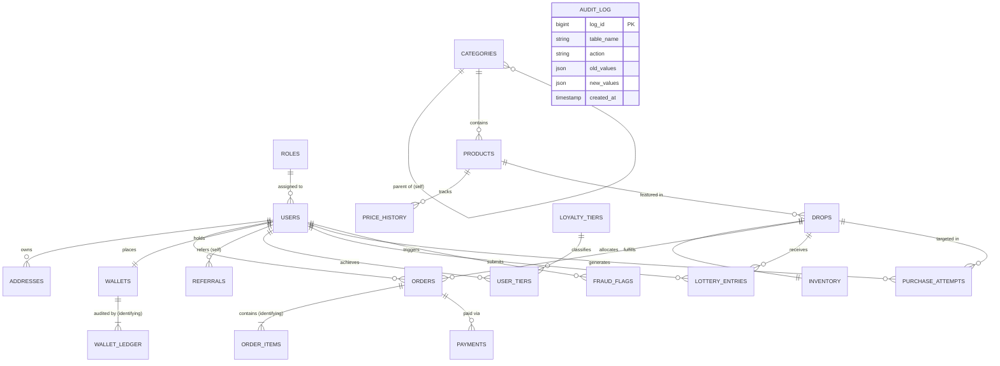

# Component 01: Entity-Relationship (ER) Diagram
**PES University DBMS Level 3 Evaluation Component 1 | Max Marks: 2**

---

## 1. Overview & Scope
FlashDrop models a high-concurrency limited-drop commerce ecosystem. The database is designed to support:
- Multi-tier product categorization with self-referencing hierarchy.
- Scheduled flash drops with strict inventory allocation.
- Order management with itemized breakdowns and payment logs.
- Double-entry financial wallet ledgers.
- Multi-level referral tree with self-referencing user associations.
- Anti-bot lottery entries, purchase attempt telemetry, and fraud detection flags.
- Comprehensive security audit logging.

Total Entities: **19 Relational Entities** in Third Normal Form (3NF) / Boyce-Codd Normal Form (BCNF).

---

## 2. Entities & Structural Classification

| Entity Name | Classification | Primary Key | Description & Cardinality Role |
| :--- | :--- | :--- | :--- |
| **`roles`** | Strong Entity | `role_id` | System authorization tiers (`admin`, `customer`, `auditor`). |
| **`users`** | Strong Entity | `user_id` | Core user identity, credentials, status (`active`, `suspended`). |
| **`addresses`** | Strong / Subordinate | `address_id` | Physical shipping addresses associated with users (1:N). |
| **`categories`** | Self-Referencing Strong | `category_id` | Hierarchical product taxonomy via `parent_id` recursive relation. |
| **`products`** | Strong Entity | `product_id` | Products available for drops, includes JSON schema attributes. |
| **`price_history`**| Weak Entity | `history_id` | Temporal price changes for products (identifying FK: `product_id`). |
| **`drops`** | Strong Entity | `drop_id` | Time-boxed release events (`scheduled`, `live`, `concluded`). |
| **`inventory`** | Strong / Associative | `inventory_id` | Physical stock assigned to a drop with `CHECK (available >= 0)`. |
| **`orders`** | Strong Entity | `order_id` | Committed checkout contracts placed by users during drops. |
| **`order_items`** | Weak / Child Entity | `item_id` | Line items belonging to an order (identifying FK: `order_id`). |
| **`payments`** | Subordinate Entity | `payment_id` | Financial transaction receipts linked to orders (1:1 / 1:N). |
| **`wallets`** | Strong Entity | `wallet_id` | Prepaid user balance container with `CHECK (balance >= 0)`. |
| **`wallet_ledger`**| Weak / Child Entity | `ledger_id` | Double-entry balance change records (identifying FK: `wallet_id`). |
| **`referrals`** | Self-Referencing Assoc.| `referral_id` | User-to-user referral tree (`referrer_id` -> `referee_id`). |
| **`loyalty_tiers`**| Strong Entity | `tier_id` | Rewards tiers (`Bronze`, `Silver`, `Gold`, `Platinum`). |
| **`user_tiers`** | Associative Entity | `id` | Historical & active user tier assignments with validity dates. |
| **`lottery_entries`**| Associative Entity | `entry_id` | Fair waiting room lottery ballot entries per user per drop. |
| **`purchase_attempts`**| Telemetry Entity | `attempt_id` | High-frequency telemetry log capturing successes & bot drops. |
| **`fraud_flags`** | Associative Entity | `flag_id` | Automated heuristic triggers flagging suspicious users. |
| **`audit_log`** | Independent Append-Only| `log_id` | System-wide immutable change log capturing DML events. |

---

## 3. Structural Relationships & Cardinality Matrix

```text
[users] 1 -------- 1 [wallets]               (Every user has exactly one wallet)
[wallets] 1 ------< [wallet_ledger]         (1:N, Wallet balance equals sum of ledger entries)
[users] 1 --------< [orders]                (1:N, User places zero or more orders)
[orders] 1 -------< [order_items]           (1:N, Identifying relationship, weak entity)
[orders] 1 -------< [payments]              (1:N, Order can have multiple payment attempts)
[drops] 1 --------< [orders]                (1:N, Drop generates multiple orders)
[drops] 1 -------- 1 [inventory]            (1:1, Drop allocates dedicated inventory pool)
[products] 1 -----< [drops]                 (1:N, Product can be featured in multiple drops)
[products] 1 -----< [price_history]         (1:N, Product price modifications over time)
[categories] 1 ---< [categories]            (1:N Self-Relationship via parent_id)
[categories] 1 ---< [products]              (1:N, Category groups multiple products)
[users] 1 --------< [referrals]             (1:N Self-Relationship: Referrer -> Referee)
[users] 1 --------< [addresses]             (1:N, User maintains shipping address book)
[users] >--------< [loyalty_tiers]          (N:M resolved via associative entity user_tiers)
[users] >--------< [drops] (Lottery)        (N:M resolved via lottery_entries)
[users] 1 --------< [fraud_flags]           (1:N, User flags generated by bot shield)
[users] 1 --------< [purchase_attempts]     (1:N, Attempt telemetry during flash drop)
```

---

## 4. Crow's Foot Entity-Relationship Diagram (Mermaid)



---

## 5. Identifying vs Non-Identifying Relationships (Viva Defense)

1. **`orders` $\rightarrow$ `order_items` (Identifying Relationship / Weak Entity)**:
   - An `order_item` cannot exist without its parent `order`. If an order is canceled before fulfillment or purged in testing, its items cease to have independent semantic meaning. The composite or foreign key reference enforces strict parent-child lifecycle linkage (`ON DELETE CASCADE`).
2. **`wallets` $\rightarrow$ `wallet_ledger` (Identifying Relationship / Weak Entity)**:
   - A `wallet_ledger` entry is an immutable delta tied strictly to a parent wallet. Ledger records are append-only; an orphaned ledger row is invalid in financial accounting.
3. **`categories` $\rightarrow$ `categories` (Self-Referencing Unary Relationship)**:
   - Modeled via `parent_id REFERENCES categories(category_id) ON DELETE RESTRICT`. Top-level categories have `parent_id IS NULL`. This structure allows arbitrary tree depth, traversed efficiently via **Recursive Common Table Expressions (CTEs)**.
4. **`users` $\rightarrow$ `referrals` (Self-Referencing Binary Relationship)**:
   - Modeled via `referrer_id` and `referee_id`, both referencing `users(user_id)`. Enforces a directed acyclic graph (DAG) representing the viral user referral tree.

---

## 6. Examiner Viva Q&A (Component 1)

**Q1: What is the difference between a strong entity and a weak entity in your schema?**
> *Defense*: A strong entity has an independent existence and a primary key derived entirely from its own attributes (e.g., `users`, `products`, `drops`). A weak entity depends existence-wise on a strong entity (identifying owner) and cannot exist without it (e.g., `order_items` cannot exist without `orders`; `wallet_ledger` cannot exist without `wallets`).

**Q2: How did you model recursive/self-referencing relationships?**
> *Defense*: We implemented two self-referencing relationships: (1) `categories` using `parent_id` pointing to `category_id` in the same table to support multi-level product hierarchies, and (2) `referrals` linking `referrer_id` and `referee_id` pointing to `users(user_id)`. We query both using MySQL 8 Recursive CTEs (`WITH RECURSIVE`).

**Q3: Why are `wallets` and `wallet_ledger` separated instead of just having a `balance` column in `users`?**
> *Defense*: Having only a mutable `balance` column violates financial auditability and introduces lost updates under concurrent transactions. By decoupling into `wallets` and an append-only `wallet_ledger`, every debit and credit is permanently recorded with transaction references, timestamps, and balance-checking triggers, guaranteeing double-entry accounting integrity.
