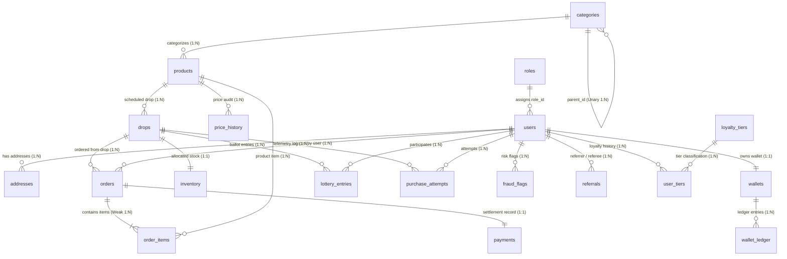

# Component 02: Relational Schema & Normalization Proofs
**PES University DBMS Level 3 Evaluation Component 2 | Max Marks: 3**

---

## 1. Visual Relational Schema Diagram

### Formal Relational Schema (20 Tables in BCNF | 152 Columns | 24 Foreign Keys)

> **High-Resolution Vector / Printable Documents**:
> - **A4 Sheet Printable Document**: [`docs/relational_schema_printable.html`](file:///C:/Users/Admin/.gemini/antigravity/scratch/flashdrop/docs/relational_schema_printable.html) (Pure white background, 3-page academic report with schema table specs)
> - **High-Resolution Vector SVG**: [`docs/relational_schema_white.svg`](file:///C:/Users/Admin/.gemini/antigravity/scratch/flashdrop/docs/relational_schema_white.svg)
> - **Relational Vector Source**: [`docs/relational_schema.svg`](file:///C:/Users/Admin/.gemini/antigravity/scratch/flashdrop/docs/relational_schema.svg)

### Structural Schema Mapping

---

## 2. ER-to-Relational Mapping Rules (Theoretical Foundation)

The transformation from the conceptual ER diagram to the relational schema follows the **7 standard algorithm steps**:

| Step | ER Construct | Relational Transformation in FlashDrop | Concrete Example in Schema |
|:---:|---|---|---|
| **1** | **Strong Entity Sets** | Create relation with all simple attributes; designated primary key becomes relation PK. | `roles`, `users`, `products`, `drops`, `loyalty_tiers` |
| **2** | **Weak Entity Sets** | Include partial key + owner entity PK as composite foreign key with `ON DELETE CASCADE`. | `order_items` (`order_id` FK + `item_id`), `wallet_ledger` (`wallet_id` FK + `ledger_id`) |
| **3** | **1:1 Relationships** | Include PK of one entity as foreign key in the other with `UNIQUE` constraint. | `users (1) ↔ (1) wallets` (`wallets.user_id UNIQUE FK`), `drops (1) ↔ (1) inventory` (`inventory.drop_id UNIQUE FK`) |
| **4** | **1:N Relationships** | Include PK of "1" side as foreign key in "N" side table. | `categories (1) ↔ (N) products` (`products.category_id FK`), `users (1) ↔ (N) orders` (`orders.user_id FK`) |
| **5** | **M:N Relationships** | Create associative bridge relation with composite PK consisting of both entities' PKs. | `users (M) ↔ (N) loyalty_tiers` resolved via `user_tiers`, `users (M) ↔ (N) drops` resolved via `lottery_entries` |
| **6** | **Recursive (Self) Relationships** | Add foreign key in same table referencing its own primary key (nullable). | `categories.parent_id → categories.category_id`, `referrals.referrer_id → users.user_id` |
| **7** | **Multi-Valued Attributes** | Modeled as either separate table or native MySQL 8 JSON column with queryable keys. | `products.attributes_json` (Size, Color, Edition) |

---

## 3. Relational Schema Representation (20 Tables)

The relational schema is defined using relational algebra notation:
`TABLE_NAME (Primary_Key_Column, Non_Key_Columns..., Foreign_Key_Column*)`

### Authentication & Users
1. **`roles`** (`role_id` PK, `role_name` UNIQUE, `description`, `created_at`)
2. **`users`** (`user_id` PK, `role_id` FK → `roles.role_id`, `email` UNIQUE, `password_hash`, `first_name`, `last_name`, `phone` UNIQUE, `status` CHECK `IN ('active', 'suspended', 'pending')`, `failed_login_count`, `created_at`, `updated_at`)
3. **`addresses`** (`address_id` PK, `user_id` FK → `users.user_id`, `address_line1`, `address_line2`, `city`, `state`, `postal_code`, `country`, `is_default`, `created_at`)

### Product Catalog & Taxonomy
4. **`categories`** (`category_id` PK, `parent_id` FK → `categories.category_id` NULLABLE, `name` UNIQUE, `slug` UNIQUE, `description`, `created_at`)
5. **`products`** (`product_id` PK, `category_id` FK → `categories.category_id`, `sku` UNIQUE, `title`, `description`, `base_price` CHECK `>= 0`, `attributes_json`, `is_active`, `created_at`, `updated_at`)
6. **`price_history`** (`history_id` PK, `product_id` FK → `products.product_id`, `old_price`, `new_price`, `changed_by_user_id` FK → `users.user_id`, `changed_at`)

### Flash Drops & Inventory
7. **`drops`** (`drop_id` PK, `product_id` FK → `products.product_id`, `title`, `slug` UNIQUE, `drop_price` CHECK `>= 0`, `start_time`, `end_time` CHECK `end_time > start_time`, `status` CHECK `IN ('draft', 'scheduled', 'live', 'paused', 'concluded')`, `max_per_user` CHECK `>= 1`, `created_at`)
8. **`inventory`** (`inventory_id` PK, `drop_id` FK → `drops.drop_id` UNIQUE, `total_allocated` CHECK `>= 0`, `reserved_holds` CHECK `>= 0`, `sold_quantity` CHECK `>= 0`, `available_quantity` CHECK `>= 0`, `version` (Optimistic locking integer), `updated_at`, CHECK `(available_quantity + reserved_holds + sold_quantity = total_allocated)`)

### Checkout, Orders & Payments
9. **`orders`** (`order_id` PK, `order_number` UNIQUE, `user_id` FK → `users.user_id`, `drop_id` FK → `drops.drop_id`, `total_amount` CHECK `>= 0`, `discount_amount` DEFAULT 0, `final_amount` CHECK `>= 0`, `status` CHECK `IN ('pending_payment', 'paid', 'failed', 'cancelled', 'refunded')`, `created_at`, `updated_at`)
10. **`order_items`** (`item_id` PK, `order_id` FK → `orders.order_id`, `product_id` FK → `products.product_id`, `quantity` CHECK `>= 1`, `unit_price` CHECK `>= 0`, `subtotal` CHECK `>= 0`)
11. **`payments`** (`payment_id` PK, `order_id` FK → `orders.order_id`, `payment_method` CHECK `IN ('wallet', 'stripe_card', 'upi')`, `transaction_reference` UNIQUE, `amount` CHECK `>= 0`, `status` CHECK `IN ('initiated', 'success', 'failed', 'refunded')`, `gateway_response_json`, `created_at`)

### Financial Wallet Ledger (Double-Entry Balanced)
12. **`wallets`** (`wallet_id` PK, `user_id` FK → `users.user_id` UNIQUE, `balance` CHECK `>= 0`, `currency` DEFAULT 'USD', `is_locked`, `updated_at`)
13. **`wallet_ledger`** (`ledger_id` PK, `wallet_id` FK → `wallets.wallet_id`, `entry_type` CHECK `IN ('CREDIT', 'DEBIT')`, `amount` CHECK `> 0`, `balance_after` CHECK `>= 0`, `reference_type` CHECK `IN ('deposit', 'order_payment', 'refund', 'referral_bonus')`, `reference_id`, `description`, `created_at`)

### Social Referrals & Loyalty Tiers
14. **`referrals`** (`referral_id` PK, `referrer_id` FK → `users.user_id`, `referee_id` FK → `users.user_id` UNIQUE, `referral_code`, `status` CHECK `IN ('registered', 'qualified', 'rewarded')`, `reward_amount` DEFAULT 0, `created_at`)
15. **`loyalty_tiers`** (`tier_id` PK, `tier_name` UNIQUE, `min_spend` CHECK `>= 0`, `discount_percentage` CHECK `BETWEEN 0 AND 100`, `early_access_minutes`, `created_at`)
16. **`user_tiers`** (`id` PK, `user_id` FK → `users.user_id`, `tier_id` FK → `loyalty_tiers.tier_id`, `achieved_at`, `expires_at`, UNIQUE(`user_id`, `tier_id`, `achieved_at`))

### Fair Waitlist Lottery, Anti-Fraud & Auditing
17. **`lottery_entries`** (`entry_id` PK, `drop_id` FK → `drops.drop_id`, `user_id` FK → `users.user_id`, `ticket_number` UNIQUE, `entry_time`, `is_winner`, `notified_at`, UNIQUE(`drop_id`, `user_id`))
18. **`purchase_attempts`** (`attempt_id` PK, `drop_id` FK → `drops.drop_id`, `user_id` FK → `users.user_id`, `ip_address`, `user_agent`, `status` CHECK `IN ('held', 'rejected_out_of_stock', 'rate_limited', 'converted')`, `latency_ms`, `attempted_at`)
19. **`fraud_flags`** (`flag_id` PK, `user_id` FK → `users.user_id`, `risk_score` CHECK `BETWEEN 0 AND 100`, `flag_reason`, `is_resolved`, `flagged_at`, `resolved_at`)
20. **`audit_log`** (`log_id` PK, `table_name`, `action` CHECK `IN ('INSERT', 'UPDATE', 'DELETE')`, `record_id`, `changed_by_user_id` NULLABLE, `old_values_json`, `new_values_json`, `created_at`)

---

## 4. Functional Dependency (FD) Analysis for Critical Tables

### Table 1: `orders`
- **Attributes**: `{ order_id, order_number, user_id, drop_id, total_amount, discount_amount, final_amount, status, created_at }`
- **Functional Dependencies**:
  - **FD₁**: `{ order_id } → { order_number, user_id, drop_id, total_amount, discount_amount, final_amount, status, created_at }`
  - **FD₂**: `{ order_number } → { order_id, user_id, drop_id, total_amount, discount_amount, final_amount, status, created_at }`
- **Candidate Keys**: `{ order_id }`, `{ order_number }`
- **Primary Key**: `order_id`
- **Proof of BCNF**: For every functional dependency `X → Y`, the determinant `X` is a superkey. There are no transitive or partial dependencies.

### Table 2: `inventory`
- **Attributes**: `{ inventory_id, drop_id, total_allocated, reserved_holds, sold_quantity, available_quantity, version, updated_at }`
- **Functional Dependencies**:
  - **FD₁**: `{ inventory_id } → { drop_id, total_allocated, reserved_holds, sold_quantity, available_quantity, version, updated_at }`
  - **FD₂**: `{ drop_id } → { inventory_id, total_allocated, reserved_holds, sold_quantity, available_quantity, version, updated_at }`
- **Candidate Keys**: `{ inventory_id }`, `{ drop_id }`
- **Primary Key**: `inventory_id`
- **Proof of BCNF**: Each determinant is a superkey. Redundancy is minimized.

### Table 3: `wallet_ledger`
- **Attributes**: `{ ledger_id, wallet_id, entry_type, amount, balance_after, reference_type, reference_id, created_at }`
- **Functional Dependencies**:
  - **FD₁**: `{ ledger_id } → { wallet_id, entry_type, amount, balance_after, reference_type, reference_id, created_at }`
- **Candidate Key**: `{ ledger_id }`
- **Primary Key**: `ledger_id`
- **Proof of BCNF**: Strict single-key determinant in full BCNF.

---

## 5. Step-by-Step Normalization Proofs

### Proof from 1NF to 3NF/BCNF:

1. **First Normal Form (1NF)**:
   - All attribute values are atomic (e.g., names are split into `first_name` and `last_name`, addresses are structured, no repeating groups or multivalued arrays).
   - Each record is uniquely identifiable by a Primary Key.

2. **Second Normal Form (2NF)**:
   - Must be in 1NF.
   - Elimination of Partial Dependencies: In composite-key tables like `order_items` (`item_id` surrogate PK with `(order_id, product_id)` unique composite constraint) and `user_tiers` (`(user_id, tier_id)`), non-prime attributes depend on the whole key, not a proper subset.

3. **Third Normal Form (3NF)**:
   - Must be in 2NF.
   - Elimination of Transitive Dependencies (`X → Y` and `Y → Z`).
   - *Example*: In `orders`, we store `user_id`, but we do NOT store `user_name` or `user_email`. Those depend on `user_id`, so keeping them in `orders` would create a transitive dependency (`order_id` → `user_id` → `user_email`). Normalization stores them exclusively in `users`.

4. **Boyce-Codd Normal Form (BCNF)**:
   - A relation is in BCNF if and only if for every non-trivial functional dependency `X → Y`, `X` is a superkey.
   - In all 20 tables in FlashDrop, all determinants are candidate keys or superkeys. Thus, the entire schema satisfies BCNF.

---

## 6. Viva Defense Questions (Component 2)

**Q1: What is the difference between 3NF and BCNF? Give an example.**
> *Defense*: 3NF permits a dependency `X → Y` if `Y` is a prime attribute (part of a candidate key), even if `X` is not a superkey. BCNF is stricter: every determinant `X` MUST be a superkey without exception. In FlashDrop, all tables have single-attribute surrogate keys or unique candidate keys, so every determinant is a superkey, ensuring full BCNF compliance.

**Q2: Did you denormalize any tables in this schema? If so, why?**
> *Defense*: In `inventory`, we maintain `available_quantity` alongside `total_allocated`, `reserved_holds`, and `sold_quantity`, protected by a database `CHECK` constraint: `(available_quantity + reserved_holds + sold_quantity = total_allocated)`. This deliberate denormalization avoids costly `COUNT(*)` aggregations over high-volume `orders` and `order_items` tables during sub-millisecond stock validation queries.

