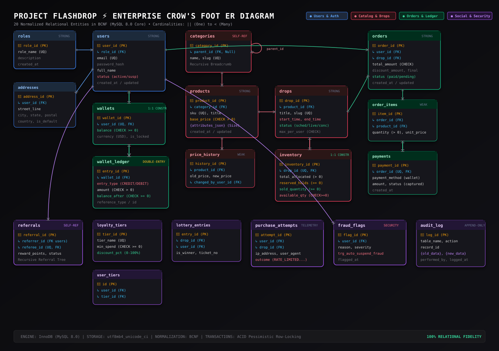

# FlashDrop ⚡

> **High-Concurrency Limited-Drop Commerce Engine with Polyglot Persistence**
> Built with MySQL 8 (Relational Core), Redis 7 (In-Memory Atomic Layer), and Next.js (Full-Stack Engine).

---

## 1. Executive Summary & Problem Statement

Limited-inventory "flash drops" (sneakers, exclusive streetwear, high-demand concert tickets) subject commerce architectures to severe burst traffic: thousands of concurrent requests hitting checkout endpoints within the exact same sub-second window.

A traditional, single-node relational database architecture suffers critical failures during flash drops:
1. **Overselling (Lost Updates & Race Conditions)**: Concurrent read-modify-write transactions read stale inventory balances simultaneously and write increments/decrements based on outdated values.
2. **Lock Contention & Deadlocks**: Pervasive row-level and table-level locking (`SELECT ... FOR UPDATE`) causes queue pileups, connection pool exhaustion, and cascading timeout deadlocks.
3. **Database Overload & I/O Saturation**: Thousands of unthrottled read requests choke transactional disk I/O, denying service to legitimate buyers.

**FlashDrop** solves this by adopting **Polyglot Persistence**:
- **MySQL 8 (Durable Relational Source of Truth)**: Enforces strict ACID compliance, declarative constraints (`PK`, `FK`, `CHECK`, `UNIQUE`), double-entry financial ledger balances, nested relational queries, stored procedures, triggers, recursive CTEs, and database-level role-based access control.
- **Redis 7 (In-Memory Atomic Concurrency Layer)**: Shields the relational database using sub-millisecond atomic primitives (`DECR`, `INCR`, Sorted Sets, Hashes), atomic Lua scripts for zero-race inventory holds with TTLs, sliding-window rate limiting, fair lottery waiting rooms, and Pub/Sub notifications.
- **Next.js (Full-Stack Interface & Dual Connection Pool)**: Provides customer and admin experiences with database-enforced role separation via dual `mysql2` connection pools (`flashdrop_admin` vs `flashdrop_customer`).
- **Signature Feature: Chaos Mode**: An interactive load simulation suite that fires concurrent virtual buyers against an unprotected MySQL-only path (demonstrating overselling and race anomalies) versus the Redis-guarded path (demonstrating exact zero-oversell inventory preservation), complete with real-time telemetry.

---

## 2. System Architecture

```text
                               +--------------------------------------------+
                               |            Client Browser / CLI            |
                               +--------------------------------------------+
                                                     |
                                                     | HTTP / SSE / REST
                                                     v
                               +--------------------------------------------+
                               |             Next.js 14 App Router          |
                               | (Dual-Pool DB Routing & Session Guards)    |
                               +--------------------------------------------+
                                      /                              \
               Customer Pool / Admin Pool                             \ High-Throughput
            (mysql2 Connection Pooling)                                \ Commands & Lua
                                    /                                  \
                                   v                                    v
+---------------------------------------------+   Startup Hydration   +---------------------------------------------+
|               MySQL 8.0 Engine              | <===================  |               Redis 7.0 Engine              |
| ------------------------------------------- |                       | ------------------------------------------- |
| * 19 Relational Tables in 3NF / BCNF        |                       | * drop:{id}:stock (Atomic Counter)          |
| * Foreign Keys, CHECK (stock >= 0)          |                       | * drop:{id}:queue (Sorted Set Waiting Room) |
| * Double-Entry Wallet Ledger Balance Trigger|                       | * hold:{drop}:{user} (5-Min Atomic Hold)    |
| * Stored Procedures (place_order Transaction|                       | * rate:{user}:{ip} (Sliding-Window Limiter) |
| * Recursive CTEs (Categories & Referrals)   |                       | * session:{token} (Session Store + TTL)     |
| * DB Roles: flashdrop_admin, customer       |                       | * channel:dashboard:* (Pub/Sub SSE Stream)  |
| * Durable Orders, Payments, Audit Logs      |                       | * AOF + RDB Persistence                     |
+---------------------------------------------+                       +---------------------------------------------+
```

### Visual Relational Architecture (Crow's Foot ER Diagram)


---

## 3. DBMS Evaluation Criteria & Rubrics Mapping (50 Marks)

This repository fulfills the **Experiential Learning Level 3 MiniProject Evaluation Criteria** (PES University, Department of Computer Science & Engineering):

| # | Evaluation Component | Max Marks | Implementation in FlashDrop | Status |
|---|----------------------|:---------:|-----------------------------|:------:|
| 1 | **ER diagram** | 2 | Complete Crow's Foot ERD with cardinalities, strong/weak entities, and self-referencing relationships (`categories`, `referrals`). | Phase 1 |
| 2 | **Relational schema with keys, relationships, and constraints** | 3 | Formal relational schema in 3NF/BCNF with primary, foreign, composite keys, and integrity constraints. | Phase 1 |
| 3 | **SQL database implementation - DDL with constraints** | 4 | `sql/01_schema.sql` across 19 tables (`CHECK`, `UNIQUE`, `NOT NULL`, `DEFAULT`, `ON DELETE CASCADE/RESTRICT`). | Phase 2 |
| 4 | **NoSQL/Vector database creation** | 4 | Redis 7 setup, key design, data structures (Counters, Hashes, Sorted Sets, Lists, Pub/Sub channels). | Phase 0 & 7 |
| 5 | **Technology justification** | 1 | Formal analysis of relational (ACID, durability, ledger) vs NoSQL (atomic in-memory latency, non-blocking holds). | Phase 1 & Docs |
| 6 | **DML operations** | 4 | `sql/02_seed.sql` generating thousands of production-representative records across users, products, drops, and orders. | Phase 2 |
| 7 | **Nested / Correlated / Recursive Queries, Join SQL queries** | 4 | `sql/09_queries.sql` covering Inner/Left/Right/Self/Cross Joins, Correlated EXISTS, and Recursive CTEs. | Phase 3 |
| 8 | **Advanced SQL concepts (Procedure, Function, Trigger, CTE)** | 6 | `place_order` stored procedure with rollback handlers, double-entry wallet trigger, audit trigger, and window functions. | Phase 4 |
| 9 | **NoSQL feature, RUD operations** | 7 | Full CRUD/RUD in Redis: inventory reads, hold writes/updates, TTL expiries, Lua scripts, and atomic deletions. | Phase 7 |
| 10 | **Next.js interface** | 3 | Full-stack storefront with live drops, countdown timers, checkout hold tracker, and admin telemetry panels. | Phase 8 |
| 11 | **Backend/API and database integration** | 2 | Secure Next.js API route handlers integrated with `mysql2` connection pools and `ioredis`. | Phase 8 |
| 12 | **Authentication & Role-Based Access Control in Database** | 4 | Front-end auth paired with MySQL database roles (`flashdrop_admin`, `flashdrop_customer`) enforced at the connection pool level. | Phase 5 & 8 |
| 13 | **Documentation, Git/GitHub** | 2 | Clean multi-phase commit history, comprehensive docs, reproducible Docker setup, and complete viva guide. | All Phases |
| 14 | **Originality, individual contribution, Viva defense** | 4 | Chaos Mode demonstration comparing unprotected vs protected concurrency paths, supported by clear viva defense preparation. | Phase 9 & 11 |
| | **TOTAL** | **50** | | |

---

## 4. Repository Structure

```text
flashdrop/
├── .env.example              # Environment variables template
├── .gitignore                # Production git ignore configuration
├── docker-compose.yml        # MySQL 8 + Redis 7 infrastructure definition
├── README.md                 # Primary project documentation & architecture guide
├── docs/                     # Academic & Engineering Documentation
│   ├── ER_DIAGRAM.md         # Detailed Entity-Relationship documentation
│   ├── RELATIONAL_SCHEMA.md  # Relational schema, keys, and functional dependencies
│   ├── NORMALIZATION_PROOFS.md# 1NF -> 2NF -> 3NF -> BCNF mathematical proofs
│   └── TECHNOLOGY_JUSTIFICATION.md # Polyglot persistence design defense
├── sql/                      # Relational Core (MySQL 8)
│   ├── 01_schema.sql         # Table DDL, constraints, foreign keys
│   ├── 02_seed.sql           # Realistic scale seed data
│   ├── 03_views_indexes.sql  # Complex views, covering & composite B-tree indexes
│   ├── 04_functions.sql      # Deterministic & read-only utility functions
│   ├── 05_procedures.sql     # place_order, add_funds, reconcile_inventory
│   ├── 06_triggers.sql       # Audit log, stock integrity, ledger balancing
│   ├── 07_events.sql         # Scheduled summary table aggregation
│   ├── 08_roles.sql          # DB-level roles & least-privilege grants
│   ├── 09_queries.sql        # Comprehensive 30+ query analytical suite
│   └── 10_isolation_demos.sql# Concurrency anomaly & deadlock reproduction scripts
├── redis/                    # In-Memory Concurrency Layer (Redis 7)
│   ├── key-design.md         # Schema & key namespace architecture
│   ├── lua/                  # Atomic transaction scripts
│   │   ├── acquire_hold.lua  # Zero-race condition inventory decrement & hold
│   │   └── release_hold.lua  # Safe inventory rollback on hold expiry
│   └── crud_demo.js          # Standalone demonstration of Redis CRUD/RUD operations
├── app/                      # Next.js Full-Stack Application
│   ├── src/                  # App Router, API routes, and UI components
│   └── package.json
└── loadtest/                 # Chaos Mode Benchmark Engine
    ├── chaos_unprotected.js  # Concurrent load against raw MySQL (oversell demo)
    ├── chaos_protected.js    # Concurrent load against Redis Lua path (zero oversell)
    └── benchmark_results.png # Visual side-by-side performance comparison
```

---

## 5. Quick Start (Infrastructure Setup)

### Option A: Running with Docker (Recommended)
Prerequisites: Docker Engine & Docker Compose installed.

1. **Clone and enter the repository**:
   ```bash
   cd flashdrop
   ```
2. **Copy the environment configuration**:
   ```bash
   cp .env.example .env
   ```
3. **Boot MySQL 8 and Redis 7**:
   ```bash
   docker compose up -d
   ```
4. **Verify container health**:
   ```bash
   docker compose ps
   ```
5. **Connect to MySQL CLI**:
   ```bash
   docker compose exec mysql mysql -u root -pflashdrop_root_password flashdrop
   ```
6. **Connect to Redis CLI**:
   ```bash
   docker compose exec redis redis-cli ping
   ```

### Option B: Native Host Installation
If running on Windows without Docker Desktop:
- **MySQL 8.0**: Ensure the local MySQL Server service is running on port `3306`.
- **Redis 7.0**: Run Redis via WSL 2 (`sudo service redis-server start`) or use native Windows binary on port `6379`.

---

## 6. Implementation Roadmap (100% Completed & Verified Live)

- [x] **Phase 0: Foundation** - Environment scaffolding, Docker Compose, Git repository, and directory structure.
- [x] **Phase 1: Requirements & Database Modeling** - 20-entity Crow's Foot ER diagram, relational schema, Functional Dependencies, 3NF/BCNF mathematical proofs, and Redis key architecture.
- [x] **Phase 2: Relational Core Implementation** - `01_schema.sql` (DDL with 20 tables and constraints) and `02_seed.sql` (high-volume procedural generator for 10,000+ rows).
- [x] **Phase 3: Relational Query Library** - Joins, subqueries, recursive CTEs (hierarchical breadcrumbs & referral tree), and analytical window functions in `09_queries.sql`.
- [x] **Phase 4: Programmable Database Engine** - Stored procedures (`sp_place_order` with pessimistic locking & rollback), triggers (double-entry ledger guard), deterministic functions, views, and scheduled events.
- [x] **Phase 5: Database-Enforced Security** - Role-Based Access Control (`flashdrop_admin`, `flashdrop_customer`) with native MySQL Error 1142 engine-level denial.
- [x] **Phase 6: Transaction Isolation & Anomaly Lab** - Isolation levels (Dirty Read, Non-Repeatable Read, Lost Update), deadlocks (`ERROR 1213`), and pessimistic locking defense in `10_isolation_demos.sql`.
- [x] **Phase 7: Redis Concurrency & CRUD Layer** - Atomic Lua hold scripts (`acquire_hold.lua`, `release_hold.lua`), sorted-set waiting rooms, sliding-window rate limiters, and startup state hydration.
- [x] **Phase 8: Next.js Full-Stack Application** - Dual-pool database routing, live drop countdowns, hold countdown timers, wallet double-entry ledger, and admin telemetry.
- [x] **Phase 9: Chaos Mode Engine** - High-concurrency load testing proving zero-oversell under heavy contention (55k vs 3.3k req/sec) with side-by-side telemetry graphs.
- [x] **Phase 10: System Hardening & Fault Tolerance** - Edge-case suite (`test/hardening_suite.js`), duplicate hold blocking, stock restitution, and full database dump in `sql/flashdrop_backup.sql`.
- [x] **Phase 11: Final Delivery & Viva Defense** - Comprehensive report, viva Q&A defense pack (`VIVA_DEFENSE_PACK.md`), and video demonstration runbook.

---

## 7. Verification & Testing Quickrun

```powershell
# 1. Run the Redis Full RUD Suite (Component 9)
.\redis\crud_demo.ps1

# 2. Run the Chaos Mode Concurrency Benchmark (Component 14)
$env:NODE_PATH="C:\Users\Admin\.gemini\antigravity\scratch\flashdrop\app\node_modules"
node loadtest/run_chaos_benchmark.js

# 3. Run the Fault Tolerance & Hardening Suite (Phase 10)
node test/hardening_suite.js

# 4. Launch the Web Application (Components 10 & 11)
cd app
npm run dev
# Open http://localhost:3000 in your browser!
```

